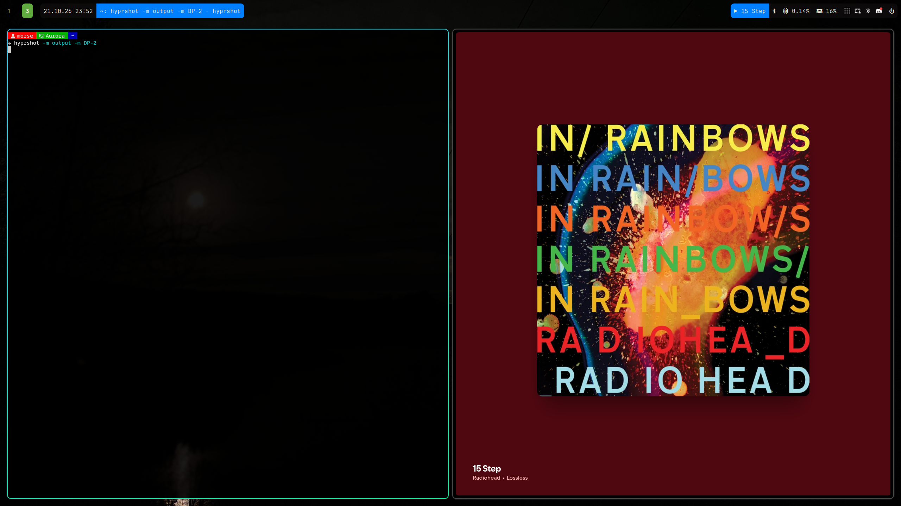

**MY DOTFILES**

_My dotfiles for Hyprland_

Run _install-dependencies.sh_ to install needed/recommended dependencies, and choose to install my default programs, if you want. _If you choose to not install them, make sure to change variables.lua to your desired applications._

hypr/modules/monitors.lua_ to change to your monitor settings.

Go into hypr/modules/variables.lua_ to change to your desired applications, keyboard layout, etc.

I have added my own backgrounds of pictures I have taken myself. It will reload a random background each time you relaunch Hyprland. Backgrounds are located in _hypr/backgrounds_, so feel free to add your own backgrounds :)

